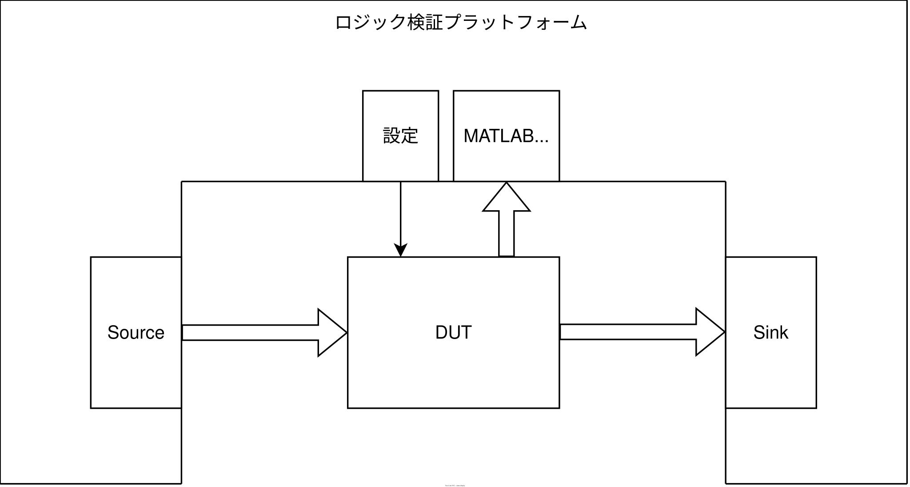
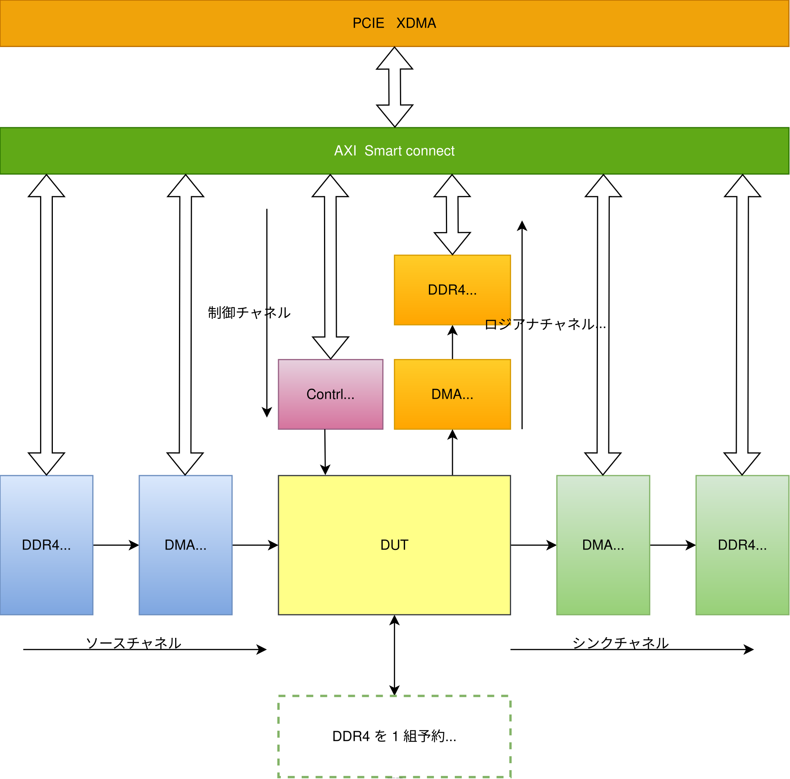
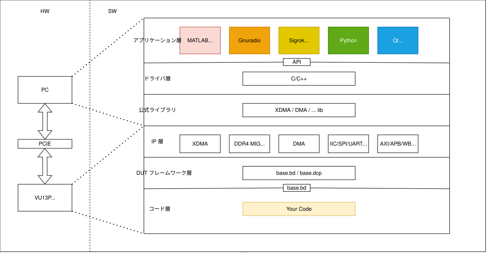

# 07 PCIe + DDR4 + DMA + DUT

注意: 本プロジェクトはまだ開発途中でリリース版ではないため、そのままでは使えません。


## 全体構成

本節では VU13P を使って、自作ロジックの検証を高速化するための基本フレームワークを設計します。
一般的な検証シナリオでは、iverilog + GTKWave で機能検証の大部分は十分にまかなえます。
しかし、長いシミュレーション時間を要するケース、特に性能シミュレーションでは、純粋なソフトウェアシミュレータでは実用上の要求を満たせません。
通常は FPGA プラットフォーム上で検証を行いますが、従来の FPGA プラットフォームではハードウェア関連のバグを頻繁にデバッグする必要があり、不要な時間を大きく浪費します。
本プロジェクトは安定して信頼性の高い VU13P ハードウェアプラットフォームをベースにしており、カードを PCIe スロットに直接挿すだけで、シンプルかつ確実に使えます。ハードウェアの問題を気にする必要はありません。
この考え方に基づき、次のような DUT 実験プラットフォームを設計しました。




一般に、DUT にはテスト入力（スティミュラス）を供給するソースと、出力データを受け取るシンクが必要で、通常は内部信号の状態を観測するロジックアナライザも必要です。ロジックによっては、内部レジスタを制御する SPI/IIC などのインターフェースも必要になります。上図のとおりです。


### 実装アーキテクチャ

上記の要件に基づき、基本フレームワークを構想しました。




上記では VU13P ボードの DDR メモリを 3 チャネル使用しており、いずれも DMA によるメモリデータの転送に用います。
1. channel1 - Source チャネルの DDR4 メモリは計 4GB。ホスト PC が PCIe インターフェース経由で継続的に DDR4 にデータを転送し、DMA モジュールが DDR4 から比較的低速（200MB/s 未満）で DUT にデータを転送します。
2. channel2 - Sink   チャネルの DDR4 メモリは計 4GB。DUT の出力データストリームを DMA モジュールに渡し、DMA が DDR4 へ転送します。ホスト PC は DMA モジュールの割り込み要求に応じて channel2 の DDR4 からデータを読み出します。
3. channel3 - LA     チャネルの DDR4 メモリは計 4GB。DUT の内部データストリームを DMA モジュールに渡し、DMA が DDR4 へ転送します。ホスト PC は DMA モジュールの割り込み要求に応じて channel3 の DDR4 からデータを読み出します。
4. channel4 - DDR4   チャネルは本プロジェクトでは使用していません。このチャネルは DUT 用に予約されており、一部の RV CPU コアは外部 DDR4 を必要とします。

### ソフトウェア／ハードウェア構成

図のとおり、本プロジェクトが提供するソフトウェア／ハードウェア構成は以下のとおりです。



1. アプリケーション層: MATLAB、gnuradio、Sigrok、python の使用例を提供し、内部レジスタを操作する Qt GUI を提供します。
2. ドライバ層: c/c++ で記述し、公式ライブラリを呼び出して、アプリケーション層に API を提供します。
3. 公式ライブラリ: いくつかの基本ライブラリ。
4. IP 層: いくつかの基本 IP。
5. フレームワーク層: `prj/07_pcie_ddr4_dma/base` が基本フレームワークを提供します。
6. コード層: ユーザーが記述します。

### 開発フロー


開発フローは上図のとおりです。
1. まず簡単な XDMA IP（`prj/00_pcie_only` を参照）を作成し、ビルドして xdma_base.dcp ファイルを生成します。後で mcap を使ってインクリメンタルビルドした bit ファイルを書き込むため、必ず同じ pcie モジュールを使う必要があります。
2. base ライブラリをビルドして base.dcp インクリメンタルビルドファイルを生成し、非常に時間のかかる DDR4・DMA・XDMA モジュールを何度もビルドし直すのを避けます。
3. `iverilog` で自作コードをシミュレーションします。`prj/07_pcie_ddr4_dma/extn/sim/` を参照してください。
4. ビルド
5. 初回ビルド時は JTAG で Tandem1.bit を PROM（QSPI Flash）に書き込む必要があります。以降は PCIe 経由でのみ bit を書き込みます。
6. ホスト PC でコード内部のロジックを確認します。
7. コードを繰り返し修正します。
8. 3 に戻ります。


## let's Goooooooooooo

### コードの設計

前置きは抜きにして、ChatGPT-4 で FIR フィルタを作成し、例として使います。

```verilog
//  Model: GPT-4
//  
// Q Verilog で FIR フィルタを書いてください。入出力ポートのビット幅は 16bit、係数は全部で 33 個、各係数のビット幅も 16bit で、係数のビット幅はポートで設定できるようにしてください
//  
// A  ご要望に基づき、以下は Verilog による FIR フィルタの実装です。16 ビット幅の入出力ポートと、16 ビット幅の係数 33 個を持ち、係数のビット幅はポートで設定できます。
//      
// Q 入力信号 data_in は符号付き数なので、乗算記号 * をそのまま使うのは正しくありません。乗算専用のサブモジュールを追加するか、xilinx ultrascale plus の乗算器プリミティブを呼び出すべきです。また加算ツリーが長すぎるので、加算ツリーにレジスタを挿入してパイプライン化すべきです
//          
// A ご提案はとても妥当です。符号付き数の乗算には専用の乗算サブモジュールを使えます。ここでは Xilinx UltraScale+ FPGA ベースの符号付き乗算器プリミティブ DSP48E1 を使った実装を示します。
//  
// Q 累算器で加算 4 回ごとに 1 段レジスタを入れたいです。
//  
// A ご要望に基づき、累算器で加算 4 回ごとにレジスタを 1 つ追加できます。以下は修正後の FIR フィルタモジュールです：
//  verilog
module fir_core (
    input wire         clk     ,
    input wire         rst     ,
    input wire  [15:0] data_in , 
    input       [15:0] coeff_00,
    input       [15:0] coeff_01,
    input       [15:0] coeff_02,
    input       [15:0] coeff_03, 
    input       [15:0] coeff_04,
    input       [15:0] coeff_05,
```


python でテスト入力データと期待値を生成します。スクリプトは AI にそのまま書いてもらいました。詳細はファイル `prj/07_pcie_ddr4_dma/extn/sim/gensource.py` を参照してください。
```python
#---Model: GPT-4
#---
#---python で 2 つの正弦波を足し合わせた信号を生成し、高周波成分を除去する 33 係数の FIR フィルタを設計して
#---Python で 2 つの正弦波を足し合わせた信号を生成し、高周波信号を除去する 33 係数の FIR フィルタを設計するには、以下のライブラリとコードを使用できます：
#---
#---必要なライブラリのインストール：
#---bash
#---pip install numpy scipy matplotlib
#---Python コードの作成：
import numpy as np
import matplotlib.pyplot as plt
from scipy.signal import firwin, lfilter
```

その他 AI にやってもらったことは、ここでは紹介しません。

本サンプルは alexforencich 氏の I2C モジュールを使用しています。次のコマンドでサブモジュールを最新化してください。
```shell
cd prj/07_pcie_ddr4_dma/extn/src/iic/iic
git pull origin master
git submodule update --init --recursive 
```

設計者が作成したファイルを確認します。


### シミュレーション環境の構築

スクリプトを書くようなことは ChatGPT4 に任せましょう


ここでは FIR フィルタを 1 つ設計し、Python でシミュレーションして結果を得ました。その後 iverilog で論理シミュレーションを行い、上図の結果を得ました。
本プロジェクトでは、iverilog + GTKWave をインストール済みであれば、スクリプトを実行するだけでシミュレーション結果を得られます。

```shell
# 1. ディレクトリに移動
cd prj/07_pcie_ddr4_dma/extn/sim
# 2. テストデータを生成
python3 gensource.py
# 3. iverilog シミュレーションを開始
make
# 4. ChatGPT-AI が書いた python スクリプトを見てみる
vim gensource.py
```


## Vivado 合成の高速化

### プロジェクトがまだ完成していないので、完成したらドキュメントを書きます


